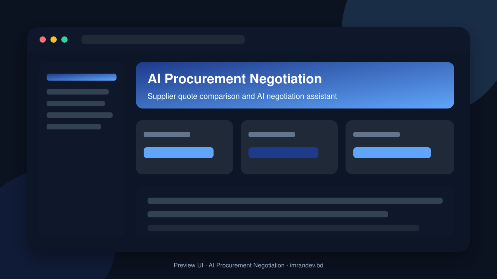
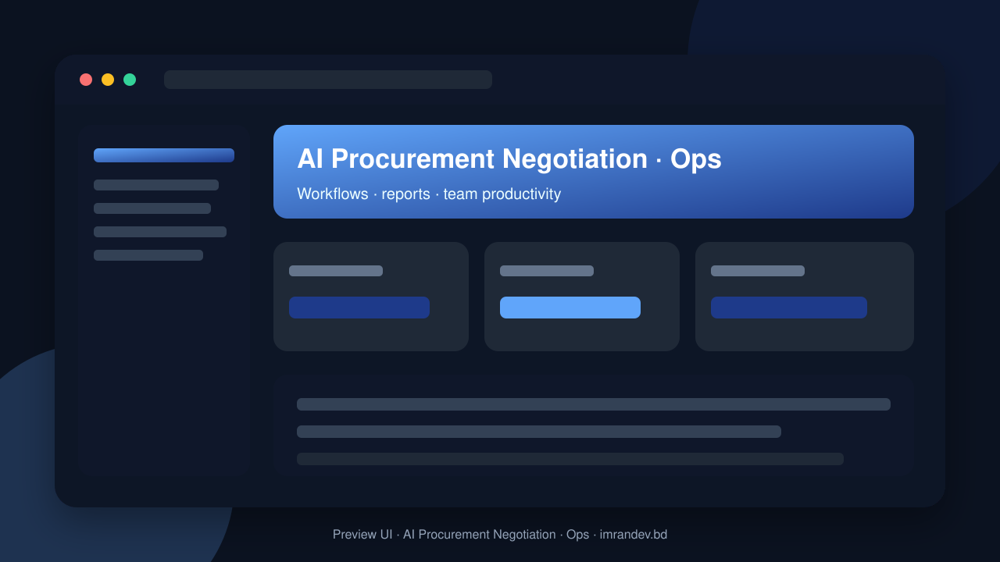

<p align="center">
  
</p>

# AI Procurement Negotiation

<p align="center"><strong>Supplier quote comparison and AI negotiation assistant</strong></p>

<p align="center">
  <a href="https://github.com/imranbru99/ai-procurement-negotiation-quote-compare"></a>
  
  
</p>

---

## Overview

**AI Procurement Negotiation** — Supplier quote comparison and AI negotiation assistant.

This README documents the **real application features** so GitHub and Google visitors can understand what the product does.

## Product screenshots

| Dashboard | Operations |
| :---: | :---: |
|  |  |

## Application features

### Procurement & AI negotiation

- RFQ / RFP creation and supplier invitations
- Supplier quote collection (portal, import, upload)
- Side-by-side quote comparison and TCO scoring
- Weighted criteria and best-value highlighting
- AI negotiation strategy and counter-offer drafts
- Negotiation rounds with savings tracking
- Award, PO generation and procure-to-pay hooks
- Module manager to enable only needed procurement modules

### Implemented application modules

- ai negotiation
- approvals
- attendance
- audit log
- awards
- backup gdpr
- budgets
- catalog
- cms
- collaboration
- contracts
- dashboard
- documents
- goods receiving
- integrations
- inventory
- invoices
- knowledge base
- modules
- multi branch
- multi currency
- multi language
- notifications
- payments
- price intelligence
- purchase orders
- quote comparison
- quotes
- requisitions
- reverse auctions
- rfq
- savings
- settings
- spend analytics
- subscription
- supplier performance
- supplier risk
- suppliers
- support
- tasks
- tenants
- users

### Admin screens (Filament resources)

- Attendance Device management
- Awards management
- Budgets management
- Catalog Category management
- Catalog Item management
- Cms Faq management
- Cms Page management
- Cms Post management
- Comment management
- Contract Clauses management
- Contracts management
- Cost Centers management
- Currency management
- Document management
- Entity management
- Exchange Rate management
- Gdpr Delete Request management
- Goods Receipts management
- Kb Article management
- Market Price management
- Payments management
- Plan management
- Purchase Order management
- Purchase Orders management
- Purchase Requisition management
- Quote management
- Quote Extraction management
- Reverse Auction management
- Rfq management
- Rfq Invitation management
- Savings Record management
- Stock Items management
- Supplier management
- Supplier Invoices management
- Supplier Risk Assessment management
- Supplier Scorecard management
- Support Ticket management
- Task management
- Tax Rule management
- Warehouses management

### Domain data models

- Ai Job
- Ai Prompt Template
- Ai Usage Log
- Approval Action
- Approval Delegation
- Approval Request
- Approval Workflow
- Auction Bid
- Award
- Award Line
- Budget
- Catalog Item
- Contract
- Contract Clause
- Contract Version
- Cost Center
- Goods Receipt
- Goods Receipt Line
- Market Price Point
- Module Definition
- Negotiation Round
- Negotiation Strategy
- Negotiation Thread
- Payment
- Plan
- Plan Module
- Price Alert
- Purchase Order
- Purchase Order Line
- Purchase Requisition
- Purchase Requisition Line
- Quote
- Quote Comparison
- Quote Extraction
- Quote Import
- Quote Line
- Reverse Auction
- Rfq
- Rfq Invitation
- Rfq Line
- Rfq Question
- Savings Record
- Scoring Criterion
- Setting
- Stock Item
- Stock Movement
- Supplier
- Supplier Invoice
- Supplier Invoice Line
- Supplier Risk Assessment
- Supplier Scorecard
- Tenant
- Tenant Module
- Tenant Subscription
- Three Way Match

## Tech stack

- PHP 8.2+ / Laravel
- Filament admin (where enabled)
- Migrations, seeders, queues
- Vite asset pipeline
- MySQL / SQLite ready

## Quick start

```bash
git clone https://github.com/imranbru99/ai-procurement-negotiation-quote-compare.git
cd ai-procurement-negotiation-quote-compare
composer install
cp .env.example .env
php artisan key:generate
php artisan migrate --seed
npm install && npm run build
php artisan serve
```

## Author

**Imran Ahmed** · https://imrandev.bd · me@imrandev.bd  
GitHub: https://github.com/imranbru99/ai-procurement-negotiation-quote-compare

---
## 🤝 Let's Connect & Collaborate

I am open to **Senior Remote Full-Stack Roles**, AI Platform Architecture Contracts, and Enterprise Technical Advisory.

| Channel | Link |
| :--- | :--- |
| Portfolio | https://imrandev.bd |
| GitHub | https://github.com/imranbru99 |
| LinkedIn | https://linkedin.com/in/imranbru99 |
| Email | me@imrandev.bd |
| WhatsApp | https://wa.me/8801576918420 |
| Packagist | https://packagist.org/packages/imrandevbd/ |

